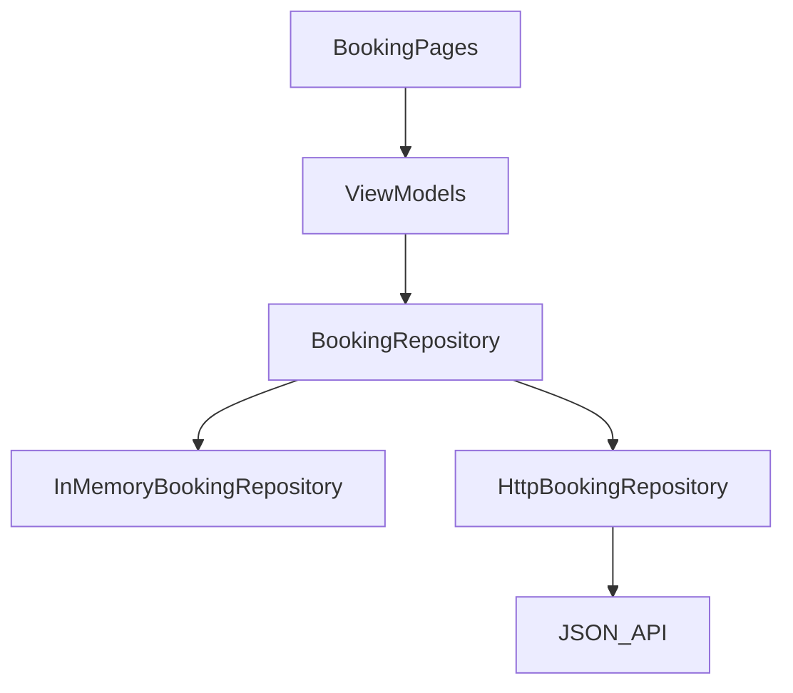

# flutter-architecture-blueprint

A small booking board that shows how a Flutter app can separate a feature's UI, domain rules, and data sources without a stack of unused layers.

The default build runs offline. The same repository interface has an HTTP implementation for a documented JSON API.

## What is implemented

- Feature-first layout under `lib/features/bookings`.
- Riverpod providers for the repository, list, detail, and create flows.
- `go_router` routes: `/bookings`, `/bookings/new`, and `/bookings/:id`.
- Typed failures for network, timeout, validation, not found, and unexpected errors.
- English and Arabic copy.
- Page-based loading, refresh, and a load-more guard that drops a second tap while a page is in flight.
- Unit tests for both repositories and the view models. Widget tests for loading, empty, error/retry, a populated list, and a deep link.

## Architecture



Decisions that match this code are in [docs/adr](docs/adr).

## Requirements

- Flutter stable 3.41.x (developed on 3.41.6) and Dart 3.11.x.

## Run

```bash
flutter pub get
flutter run
```

Point the HTTP implementation at an API that speaks the contract below:

```bash
flutter run --dart-define=API_BASE_URL=https://api.example.test/v1/
```

When `API_BASE_URL` is unset, the app seeds three bookings in memory. That data is discarded when the process exits.

## API contract

`GET /bookings?page=1&pageSize=20`

```json
{
  "items": [
    {
      "id": "b1",
      "title": "Studio review",
      "customerName": "Noura Hassan",
      "startAt": "2026-06-02T11:00:00.000Z",
      "status": "scheduled"
    }
  ],
  "page": 1,
  "pageSize": 20,
  "totalCount": 1
}
```

`GET /bookings/{id}` returns one booking object.

`POST /bookings` accepts `title`, `customerName`, and `startAt`. `status` values are `scheduled`, `completed`, and `cancelled`.

`422` may return field codes the client already understands:

```json
{ "fields": { "title": "required", "startAt": "mustBeFuture" } }
```

`404` is not found. Any other non-2xx response is an unexpected failure. The client also validates a draft locally before it sends the request.

## Tests

```bash
dart format --output=none --set-exit-if-changed .
flutter analyze
flutter test
```

## Limitations

- No authentication, persistence, or conflict handling on create.
- Pagination here is page-based and specific to bookings. It is not a reusable paging package.
- `UnexpectedFailure` has no public message. The UI shows a generic translated string on purpose.
- CI is defined in `.github/workflows/ci.yml`. This README does not show a status badge until that workflow has passed on GitHub.

## License

[MIT](LICENSE)
